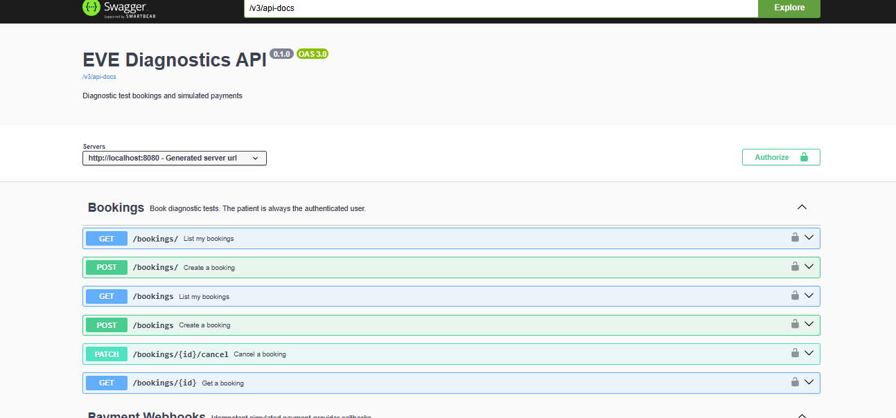
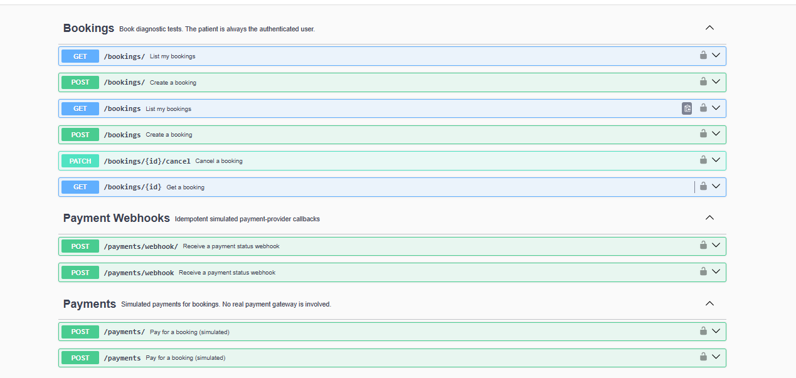
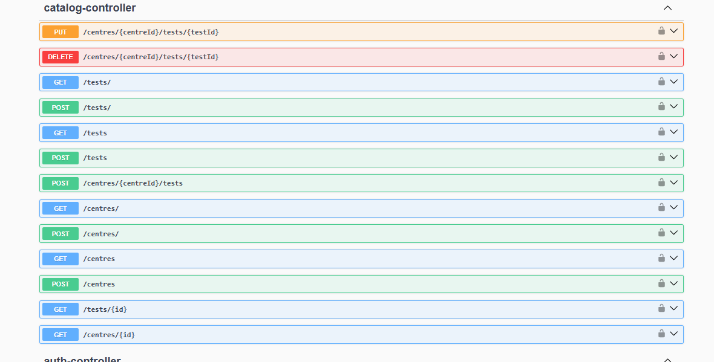
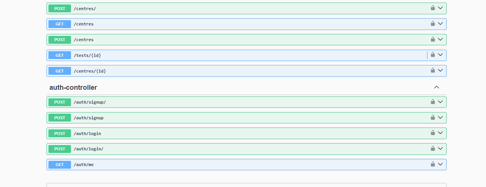

# EVE Healthcare Diagnostics API

A small Spring Boot backend for diagnostic test bookings and simulated payments. It covers user authentication, diagnostic centres and tests, bookings, simulated payments, and an idempotent payment webhook.

## Tech stack

- Java 17
- Spring Boot 3.3
- Spring Web
- Spring Security + JWT
- Spring Data JPA / Hibernate
- PostgreSQL
- Swagger 
- Flyway
- Bean Validation
- Maven
- Docker Compose

## Main features

- User signup and login with JWT authentication
- BCrypt password hashing
- Admin-only management of diagnostic centres, tests, and centre/test prices
- Public catalogue browsing with pagination and search/filtering
- User-owned diagnostic test bookings
- Server-side booking price snapshots
- Booking state management: `PENDING`, `CONFIRMED`, `FAILED`, `CANCELLED`
- Simulated payment processing with `SUCCESS` or `FAILED` results
- Payment amount protection and one payment per booking
- HMAC-signed payment webhook
- Durable webhook idempotency using the provider event ID
- Consistent API error responses and request IDs
- Flyway database migrations
- Docker Compose setup for PostgreSQL and the application

## Project structure

```text
src/main/java/com/evehealthcare/diagnostics/
├── auth/          signup, login, user responses
├── booking/       booking entity, service, repository, controller
├── catalog/       centres, tests, centre/test pricing
├── common/        shared pagination and request ID handling
├── config/        security, OpenAPI, admin seeding, clock
├── exception/     API exceptions and global error handling
├── payment/       payments, simulated gateway, webhook and idempotency
├── security/      JWT authentication
└── user/          user entity and roles

src/main/resources/db/migration/
├── V1__users.sql
├── V2__catalog.sql
├── V3__bookings.sql
├── V4__payments.sql
├── V5__payment_webhook_events.sql
└── V6__payment_webhook_event_amount.sql
```

## Architecture

The application is organized by feature. Controllers handle HTTP requests, services contain business rules, repositories handle persistence, and DTOs define API input/output models.

The main business flow is:

```text
Signup/Login
    ↓
JWT authentication
    ↓
Browse centres and tests
    ↓
Create booking (PENDING)
    ↓
Simulated payment
    ├── SUCCESS → CONFIRMED
    └── FAILED  → FAILED

Payment provider webhook
    ↓
Verify HMAC signature
    ↓
Check event ID
    ↓
Process once / safely ignore a retry
```

## Database design

### Users

Stores application users and their role (`USER` or `ADMIN`). Email addresses are unique case-insensitively.

### Diagnostic centres

Stores centre name, location and optional address.

### Diagnostic tests

Stores the diagnostic test name and optional description.

### Centre tests

Connects a centre with a test and stores the price offered by that centre. `(centre_id, test_id)` is unique.

### Bookings

A booking belongs to one user, one centre and one diagnostic test. The booking stores the appointment time and a price snapshot. This means later price changes at the centre do not change an existing booking amount.

### Payments

Each booking can have at most one payment. Payment transaction references are unique.

### Payment webhook events

Stores the provider's event ID, transaction reference, status and amount. The event ID is unique and acts as the idempotency key.

## Authentication

### Signup

```http
POST /auth/signup
Content-Type: application/json
```

```json
{
  "name": "John Doe",
  "email": "john@example.com",
  "password": "Password123"
}
```

The server assigns the `USER` role. A role cannot be selected through signup.

### Login

```http
POST /auth/login
Content-Type: application/json
```

```json
{
  "email": "john@example.com",
  "password": "Password123"
}
```

The response contains a Bearer JWT. Use it on protected endpoints:

```http
Authorization: Bearer <token>
```

### Current user

```http
GET /auth/me
Authorization: Bearer <token>
```

Passwords are stored as BCrypt hashes.

## Diagnostic centres and tests

Catalogue GET endpoints are public. Creating or changing catalogue data requires the `ADMIN` role.

### Tests

```http
POST /tests
GET /tests
GET /tests/{id}
```

Example:

```json
{
  "name": "CBC",
  "description": "Complete blood count"
}
```

`GET /tests` supports `q`, `page`, and `size` query parameters.

### Centres

```http
POST /centres
GET /centres
GET /centres/{id}
```

Example:

```json
{
  "name": "EVE Diagnostics",
  "location": "Jabalpur",
  "address": "Main Road"
}
```

`GET /centres` supports `location`, `test`, `page`, and `size` query parameters.

### Centre/test offerings

```http
POST /centres/{centreId}/tests
PUT /centres/{centreId}/tests/{testId}
DELETE /centres/{centreId}/tests/{testId}
```

Example:

```json
{
  "testId": 1,
  "price": 1499.50
}
```

Prices use `BigDecimal`/PostgreSQL `NUMERIC(10,2)` and must be greater than zero.

## Booking API

All booking endpoints require a JWT. The authenticated user is always the patient.

### Create booking

```http
POST /bookings
Authorization: Bearer <token>
Content-Type: application/json
```

```json
{
  "centreId": 1,
  "testId": 1,
  "appointmentDateTime": "2026-10-15T10:30:00"
}
```

The server:

- gets the user from the JWT
- checks that the centre and test exist
- checks that the centre offers the requested test
- takes the current centre price
- creates the booking as `PENDING`
- rejects appointments in the past or more than 90 days ahead

The client cannot choose the booking user, status, or amount.

### List my bookings

```http
GET /bookings?page=0&size=20
Authorization: Bearer <token>
```

Only the authenticated user's bookings are returned.

### Get a booking

```http
GET /bookings/{id}
Authorization: Bearer <token>
```

A normal user can only access their own booking.

### Cancel a booking

```http
PATCH /bookings/{id}/cancel
Authorization: Bearer <token>
```

`PENDING` bookings can be cancelled. A `CONFIRMED` booking can be cancelled only before its appointment starts. `FAILED` and already `CANCELLED` bookings cannot be cancelled.

## Simulated payment

No real payment provider is integrated.

### Pay for a booking

```http
POST /payments
Authorization: Bearer <token>
Content-Type: application/json
```

```json
{
  "bookingId": 1,
  "amount": 1499.50
}
```

`amount` is optional. If supplied, it must match the booking amount. The actual charge always uses the server-side booking amount.

The simulated gateway returns either `SUCCESS` or `FAILED` according to `PAYMENT_SUCCESS_RATE`.

Resulting booking states:

```text
PENDING + SUCCESS → CONFIRMED
PENDING + FAILED  → FAILED
```

The payment and booking update run in one transaction, and the booking row is locked while the payment is processed to prevent concurrent payment attempts from both succeeding.

## Payment webhook

The simulated provider sends status updates to:

```http
POST /payments/webhook
Content-Type: application/json
X-Webhook-Signature: sha256=<signature>
```

Example payload:

```json
{
  "eventId": "evt-001",
  "transactionReference": "txn-abc123",
  "status": "SUCCESS",
  "amount": 1499.50
}
```

The signature is an HMAC-SHA256 signature of the exact JSON request body using `WEBHOOK_SECRET`.

### Idempotency

`eventId` is stored in `payment_webhook_events` with a database unique constraint.

When the same event is delivered again:

1. The stored event is found.
2. Its transaction reference, status, and amount are compared with the new payload.
3. If they match, the webhook is treated as a safe duplicate and the existing result is returned.
4. If the same `eventId` is reused with different event data, the request is rejected with a conflict.

This prevents repeated provider deliveries from creating duplicate business effects.

## Error responses

Application errors use a consistent JSON structure. A typical error looks like:

```json
{
  "timestamp": "2026-10-01T12:00:00Z",
  "status": 404,
  "error": "Not Found",
  "message": "Booking 99 not found",
  "path": "/bookings/99"
}
```

A request ID is included in application logs and response headers to help trace requests.

## Configuration

The application reads the following environment variables:

| Variable | Purpose | Default |
|---|---|---|
| `DB_URL` | PostgreSQL JDBC URL | `jdbc:postgresql://localhost:5432/diagnostics` |
| `DB_USERNAME` | Database username | `diagnostics` |
| `DB_PASSWORD` | Database password | `diagnostics` |
| `JWT_SECRET` | JWT signing secret | required |
| `JWT_EXPIRATION_MINUTES` | JWT lifetime | `60` |
| `WEBHOOK_SECRET` | Webhook HMAC secret | required |
| `PAYMENT_SUCCESS_RATE` | Simulated gateway success probability | `0.8` |
| `BOOKING_ZONE` | Time zone used for appointment validation | `Asia/Kolkata` |
| `ADMIN_EMAIL` | Seed admin email | required |
| `ADMIN_PASSWORD` | Seed admin password | required |

Do not commit real secret values. For local development, environment variables can be supplied by your shell or a local `.env`/IDE configuration that remains untracked.

## Run locally

### Prerequisites

- Java 17+
- Maven 3.9+
- PostgreSQL 14+

Create a PostgreSQL database named `diagnostics`, or use the Docker Compose setup below.

Set the required values:

```bash
export JWT_SECRET='replace-with-a-long-random-secret'
export WEBHOOK_SECRET='replace-with-a-long-random-secret'
export ADMIN_EMAIL='admin@example.com'
export ADMIN_PASSWORD='AdminPassword123'
```

Then start the application:

```bash
./mvnw spring-boot:run
```

If the repository does not include the Maven wrapper, use:

```bash
mvn spring-boot:run
```

Flyway runs the database migrations automatically on startup.

## Docker Compose

Docker Compose starts PostgreSQL and the Spring Boot application.

Set the required application secrets first:

```bash
export JWT_SECRET='replace-with-a-long-random-secret'
export WEBHOOK_SECRET='replace-with-a-long-random-secret'
export ADMIN_EMAIL='admin@example.com'
export ADMIN_PASSWORD='AdminPassword123'
```

Then run:

```bash
docker compose up --build
```

The API is available at:

```text
http://localhost:8080
```

Stop the services with:

```bash
docker compose down
```

Use `docker compose down -v` only when you intentionally want to remove the PostgreSQL volume and its data.

## Swagger / OpenAPI

When the application is running, Swagger UI is available at:

```text
http://localhost:8080/swagger-ui.html
```




```

## Tests

The repository contains unit/service tests for booking, payment, simulated gateway, webhook processing, and webhook signatures.

Run the complete suite with:

```bash
mvn test
```

The comprehensive test and integration verification should be performed before submission.

## Important assumptions

- The simulated payment provider responds synchronously for the `/payments` API.
- A booking has one payment attempt. A failed payment leaves the booking in `FAILED`, and the current API requires a new booking for another payment attempt.
- Appointment times are supplied as zone-less `LocalDateTime` values and interpreted using `BOOKING_ZONE`.
- A booking stores the centre price at the time it is created, so later catalogue price changes do not alter existing bookings.
- The payment webhook is a simulated provider endpoint. Its authenticity is checked with the configured HMAC secret.
- Webhook event IDs are assumed to be unique identifiers supplied by the provider.

## Known limitations / possible improvements

- The payment provider is simulated and does not integrate with a real gateway.
- There is no real appointment-slot inventory or conflict detection between bookings.
- Redis caching, background jobs, rate limiting, and retry queues are not implemented.
- More controller-level and database integration tests can be added for broader coverage.
- Production deployment would need managed secrets, database migrations in the deployment pipeline, monitoring, and a real payment-provider integration.

## Assignment coverage

| Area | Status |
|---|---|
| User signup/login/JWT | Done |
| Diagnostic centres and tests | Done |
| Booking system | Done |
| Simulated payment | Done |
| Payment webhook | Done |
| Webhook idempotency | Done |
| Edge-case handling | Implemented; comprehensive verification pending final test phase |
| Tests | Present; full verification pending final test phase |
| README/documentation | Done |
| Optional Redis/Celery/rate limiting | Not implemented |


